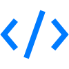
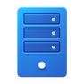
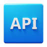
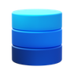
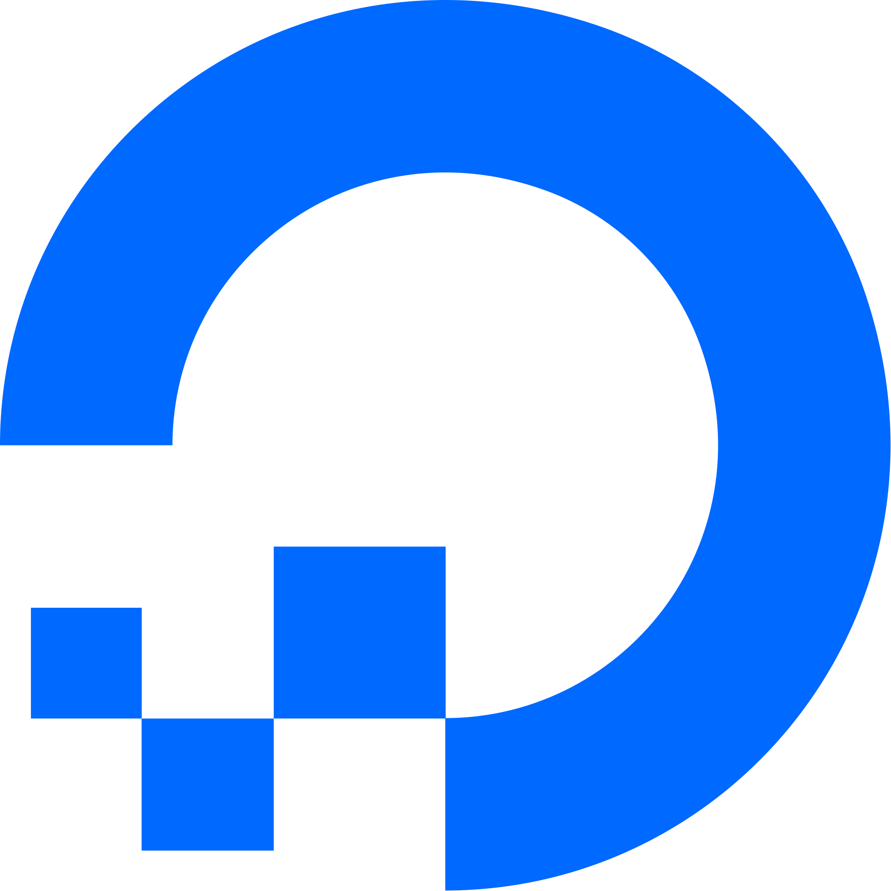

<!-- Animated Circuit Board Header -->

<!-- Dynamic Typing Effect -->

  

 
 

<!-- Status Badges & Social Links -->

  
  
  
  
  
  
  

 
 
 

<!-- About Me Section -->

  
   
  <strong>About Me & Expertise</strong>
   
  Transforming complex problems into elegant, scalable digital solutions
    

 

<table width="100%">
<tr>
<td width="60%" valign="center">

I’ve spent the last **12+ years** building software that solves real business problems.

Today I focus on two things: **WordPress websites with Divi & Elementor** for businesses, and **modern web apps with React, Next.js & Firebase**. I also run **[Pixoner Lab](https://pixonerlab.com/)**, where I build gentle learning apps for kids.

To me, you aren't just a ticket number. I take the time to look beyond the technical specs and understand your vision, ensuring we build a solution that actually drives growth. Whether it's a complex SaaS platform or a custom automation tool, I deliver code that is **clean, secure, and reliable.**

 

**Honest advice, transparent work, and results you can build on.**

</td>
<td width="40%" align="center">
  
</td>
</tr>
</table>

 
 
 
<!-- Services Card View -->
<!-- Services Card View -->

  
   
  <strong>Premium Services & Solutions</strong>
   
  Delivering excellence through modern technologies and best practices
    

 

<table width="100%" border="0">
  <!-- Row 1 -->
  <tr>
    <td width="50%" align="center" valign="top">
      
      <h3>Frontend Excellence</h3>
      
        
      Building **lightning-fast**, accessible, and scalable user interfaces with Core Web Vitals focus.
        
      
      
      
    </td>
    <td width="50%" align="center" valign="top">
      
      <h3>Full-Stack Solutions</h3>
      
        
      Robust full-stack apps with secure backend architectures and seamless **client-server integration**.
        
      
      
      
    </td>
  </tr>
  
  <!-- Row 2 -->
  <tr>
    <td width="50%" align="center" valign="top">
      
      <h3>SaaS Architecture</h3>
      
        
      Production-ready SaaS platforms with **multi-tenancy**, role-based access, and cloud deployments.
        
      
      
      
    </td>
    <td width="50%" align="center" valign="top">
      
      <h3>API Development</h3>
      
        
      Efficient REST and GraphQL APIs optimized for speed, security, and **scalability**.
        
      
      
      
    </td>
  </tr>

  <!-- Row 3 -->
  <tr>
    <td width="50%" align="center" valign="top">
      
      <h3>Real-time BaaS</h3>
      
        
      Rapid development with serverless backends, **real-time sync**, and secure cloud functions.
        
      
      
      
    </td>
    <td width="50%" align="center" valign="top">
      
      <h3>WordPress (Divi & Elementor)</h3>
      
        
      Fast business websites with **Divi & Elementor**, plus custom themes and plugins when a builder is not enough.
        
      
      
      
    </td>
  </tr>

  <!-- Row 4 -->
  <tr>
    <td width="50%" align="center" valign="top">
      
      <h3>Laravel Ecosystem</h3>
      
        
      Building robust apps with **Inertia.js**, Livewire, and scalable APIs using modern frontend stacks.
        
      
      
      
    </td>
    <td width="50%" align="center" valign="top">
      
      <h3>Performance & SEO</h3>
      
        
      Optimizing **Core Web Vitals**, rankings, and conversion rates for peak performance.
        
      
      
      
    </td>
  </tr>
</table>

 
 
 

<!-- Tech Stack Section -->
<!-- Tech Stack Section -->

  
   
  <strong>Tech Stack</strong>
   
  The modern technologies I use to build scalable solutions
    

<table border="0" width="100%" cellpadding="20">
    <tr>
        <td align="center"> JavaScript</td>
        <td align="center"> TypeScript</td>
        <td align="center"> React</td>
        <td align="center"> Next.js</td>
        <td align="center"> Node.js</td>
        <td align="center"> Express</td>
        <td align="center"> Tailwind</td>
    </tr>
    <tr>
        <td align="center"> HTML5</td>
        <td align="center"> CSS3</td>
        <td align="center"> PHP</td>
        <td align="center"> Laravel</td>
        <td align="center"> WordPress</td>
        <td align="center"> Shopify</td>
        <td align="center"> MySQL</td>
    </tr>
    <tr>
        <td align="center"> MongoDB</td>
        <td align="center"> PostgreSQL</td>
        <td align="center"> Firebase</td>
        <td align="center"> Supabase</td>
        <td align="center"> Prisma</td>
        <td align="center"> Docker</td>
        <td align="center"> AWS</td>
    </tr>
    <tr>
        <td align="center"> DigitalOcean</td>
        <td align="center"> Vercel</td>
        <td align="center"> Netlify</td>
        <td align="center"> Git</td>
        <td align="center"> GitHub</td>
        <td align="center"> Figma</td>
        <td align="center"> Linux</td>
    </tr>
</table>

 
 
 
<!-- Featured Projects -->
<!-- Featured Projects -->

  
   
  <strong>Featured Projects</strong>
   
  Recent work showcasing my technical capabilities
    

<table border="0" width="100%">
  <tr>
    <td width="55%" align="center">
      
    </td>
    <td width="45%" valign="top">
      <h3 align="left">Pixoner Lab</h3>
      

        My own small studio for <b>kids' learning apps and games</b>: letters, numbers, colours and shapes taught through play, with calm design that is safe for families.
      

      <a href="https://pixonerlab.com/">🌐 Visit pixonerlab.com</a>
    </td>
  </tr>
  <tr>
    <td width="55%" align="center">
      
    </td>
    <td width="45%" valign="top">
      <h3 align="left">PexT – SaaS Landing Page</h3>
      

        A modern SaaS landing page with hero, features, pricing, dashboard preview and testimonials. Reusable components, typed data and a mobile-first layout.
      

      

        <b>Tech Stack:</b> 
        
        
        
      

      <a href="https://pex-t-next-js-and-tailwind-css-landing-page.vercel.app/">🚀 Live Demo</a> &nbsp;·&nbsp;
      <a href="https://github.com/iamOmarFaruk/PexT--Next-JS-and-tailwind-css-landing-page">💻 Source Code</a>
    </td>
  </tr>
  <tr>
    <td width="55%" align="center">
      
    </td>
    <td width="45%" valign="top">
      <h3 align="left">PDM Job Board – WordPress Plugin</h3>
      

        A modern, lightweight job board plugin for WordPress.
      

      <a href="https://github.com/iamOmarFaruk/pdm-job-board">💻 Source Code</a>
    </td>
  </tr>
</table>

 

<!-- Client Websites -->

  <strong>Some Client Websites I Built</strong>
    

| Website | Business | Built with |
|---|---|---|
| [atecair.com](https://atecair.com) | HVAC company, Florida | WordPress + Divi |
| [volusiaflaglerac.com](https://volusiaflaglerac.com) | HVAC company, Florida | WordPress + Divi |
| [yourchironsb.com](https://www.yourchironsb.com) | Chiropractic clinic, Florida | WordPress + Elementor |
| [contourlight.com](https://contourlight.com) | Red light therapy brand | WordPress + Divi |
| [christmascometrue.org](https://christmascometrue.org) | Non-profit, Florida | WordPress + Divi |

 
 
 
<!-- Testimonials -->
<!-- Testimonials -->

  
   
  <strong>What Clients Say</strong>
   
  Feedback from satisfied clients around the globe
    

<table border="0" width="100%">
  <tr>
    <td width="33%" align="center" valign="top">
      
        
      "Very good service. He problem solved really well and gave us a better solution than we had hoped for! I will definitely use again."
        
      <b>— Alex Steffan</b>
    </td>
    <td width="33%" align="center" valign="top">
      
        
      "Omar is a great React, Next.js, and Express (MERN) expert and can build stunning websites. We're always impressed with the quality."
        
      <b>— Corinne Fisher</b>
    </td>
    <td width="33%" align="center" valign="top">
      
        
      "Omar did a remarkable job on my site and communicated well. My regular developer might not have been able to do as good a job as him."
        
      <b>— Udam Epa</b>
    </td>
  </tr>
</table>

  Clean code is written by someone who cares — Omar

